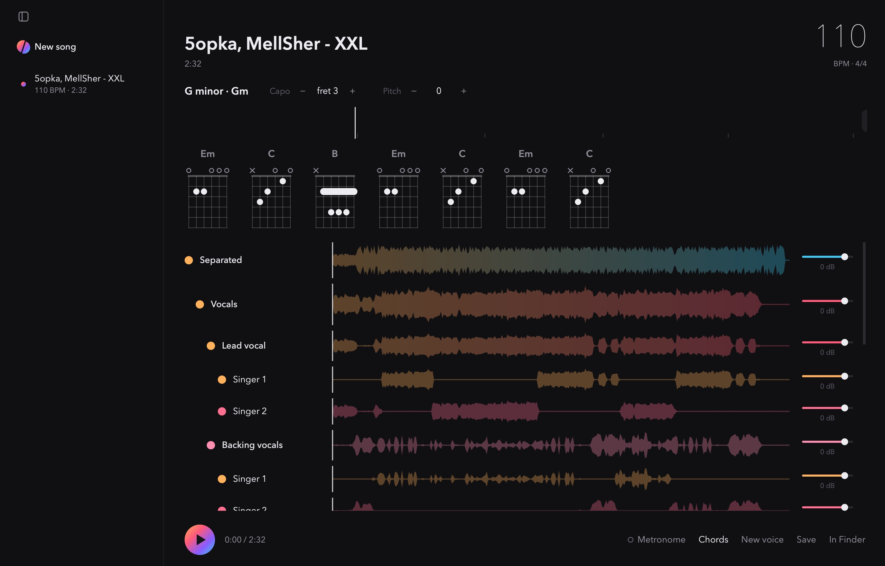

# Severance

Splits a song into vocals and music, then further: lead and backing vocals,
individual singers, drums, bass, guitar, keys. Finds the tempo and guitar
chords, and can replace the singer's voice. Runs on your Mac.

[Русский](#severance-1)



## Download

**[Severance.dmg](https://github.com/Drtonix/Severance/releases/latest/download/Severance.dmg)**

First launch goes through right-click → **Open** → **Open**.

## Requirements

Apple Silicon, macOS 14 or newer.

## Measured

MacBook Pro, M4 Max, 36 GB. A 2:32 song: vocals, music, tempo and chords in
47 s. Voice change: about 2 minutes per song in the fast mode, 3 in the clean
one.

## Features

**Sources.** A file, a video or a link: YouTube, VK, SoundCloud and anything
else yt-dlp opens.

**Parts.** Vocals split into lead and backing, then by singer; music into
drums, bass, guitar, keys and other instruments; drums into kick, snare, toms,
hi-hat and cymbals; the rest by timbre. **Split all** finds the lyrics and
goes until nothing is left to split; any step can be skipped.

**Singers.** The number is guessed from the title ("A, B feat. C") or set by
hand. A misheard piece can be selected and moved to another singer.

**Mixing.** Mute, solo and volume on every track; the original and all
separated tracks switch with one click.

**Tempo and chords.** BPM with a metronome on the detected beats. Chords for
guitar with the key, a suggested capo, transposition and fingerings.

**Lyrics.** Karaoke with every word timed to the voice, or the lyrics with
chords above the words. Text comes from LRCLIB when the song is there,
otherwise it is recognised from the separated vocals (Whisper large-v3).

**Channels.** Any track splits into its left and right channels.

**Spectrogram.** Any track on a log frequency scale; hover shows the time,
frequency, note and level, the wheel zooms.

**New voice.** The singer's voice replaced with one from any song, recording or
video (Seed-VC). Or your own recording of the song fitted to the original: timing
and melody follow the original singer, the voice stays yours. Saved as a vocal
track and as a cover.

**Export.** The current mix, the whole song without chosen tracks, one track or
all of them, in MP3, WAV or FLAC.

**Languages.** Russian and English, light and dark appearance.

## Build

```
git clone git@github.com:Drtonix/Severance.git
cd Severance
uv sync
(cd voice && uv sync)
./build_app.sh
```

To run from source: `uv run python app.py`.

## Limits

- Two similar voices of the same register get mixed up more often.
- Some VK tracks open only after signing in to VK in a browser; reading the
  browser's cookies needs Full Disk Access.

## Support

[DonationAlerts](https://www.donationalerts.com/r/bdub) · [DALINK](https://dalink.to/bdub) · [CloudTips](https://pay.cloudtips.ru/p/4a29ea73)

USDT TRC-20: `TEzUu8mVuNS1faHGobMWifmvErTuKUSkPD`

## License

MIT, see [LICENSE](LICENSE). `voice/` uses Seed-VC and is GPL-3.0, see
[voice/LICENSE](voice/LICENSE). Bundled components and models are in
[THIRD-PARTY.md](THIRD-PARTY.md).

DrTonix · [bdub.space](https://bdub.space)

---

# Severance

Делит песню на голос и музыку, а их — дальше: основной голос и бэк-вокал,
отдельные исполнители, барабаны, бас, гитара, клавишные. Находит темп и
аккорды для гитары, умеет заменить голос исполнителя. Работает на вашем Mac.

[English](#severance)


## Скачать

**[Severance.dmg](https://github.com/Drtonix/Severance/releases/latest/download/Severance.dmg)**

Первый запуск — правой кнопкой → **Открыть** → **Открыть**.

## Требования

Apple Silicon, macOS 14 или новее.

## Замеры

MacBook Pro, M4 Max, 36 ГБ. Песня на 2:32: голос, музыка, темп и аккорды —
47 с. Смена голоса — около 2 минут на песню в быстром режиме, 3 в чистом.

## Возможности

**Источник.** Файл, видео или ссылка: YouTube, VK, SoundCloud и всё, что
открывает yt-dlp.

**Части.** Голос — на основной и бэк-вокал, потом по исполнителям; музыка —
на барабаны, бас, гитару, клавишные и другие инструменты; барабаны — на бочку,
малый, томы, хай-хэт и тарелки; остальное — по тембру. **Разложить всё**
находит текст и идёт, пока делить больше нечего; любой шаг можно пропустить.

**Исполнители.** Число угадывается по названию («A, B feat. C») или задаётся
вручную. Ошибочный кусок можно выделить и отдать другому исполнителю.

**Сведение.** Выключение, соло и громкость у каждой дорожки; оригинал и всё
разложенное переключаются одним щелчком.

**Темп и аккорды.** BPM с метрономом по найденным ударам. Аккорды для гитары
с тональностью, подсказкой каподастра, транспонированием и аппликатурами.

**Текст.** Караоке, где каждое слово идёт в такт голосу, или текст с
аккордами над словами. Текст берётся из LRCLIB, если песня там есть, иначе
распознаётся по отделённому голосу (Whisper large-v3).

**Каналы.** Любая дорожка делится на левый и правый каналы.

**Спектрограмма.** Любая дорожка в логарифмической шкале частот; под курсором
время, частота, нота и громкость, колесо меняет масштаб.

**Новый голос.** Голос исполнителя заменяется голосом из любой песни, записи
или видео (Seed-VC). Или своя запись песни подгоняется под оригинал: время и
мелодия — как у исполнителя, голос остаётся своим. Сохраняется дорожкой голоса
и кавером.

**Сохранение.** То, что звучит сейчас, вся песня без выбранных дорожек, одна
дорожка или все — в MP3, WAV или FLAC.

**Языки.** Русский и английский, светлое и тёмное оформление.

## Сборка

```
git clone git@github.com:Drtonix/Severance.git
cd Severance
uv sync
(cd voice && uv sync)
./build_app.sh
```

Из исходников: `uv run python app.py`.

## Ограничения

- Два похожих голоса одного регистра путаются чаще.
- Часть записей ВКонтакте открывается только после входа во ВКонтакте в
  браузере; для чтения cookies браузера нужен полный доступ к диску.

## Поддержать

[DonationAlerts](https://www.donationalerts.com/r/bdub) · [DALINK](https://dalink.to/bdub) · [CloudTips](https://pay.cloudtips.ru/p/4a29ea73)

USDT TRC-20: `TEzUu8mVuNS1faHGobMWifmvErTuKUSkPD`

## Лицензия

MIT, см. [LICENSE](LICENSE). `voice/` использует Seed-VC и идёт под GPL-3.0,
см. [voice/LICENSE](voice/LICENSE). Компоненты и модели — в
[THIRD-PARTY.md](THIRD-PARTY.md).

DrTonix · [bdub.space](https://bdub.space)
